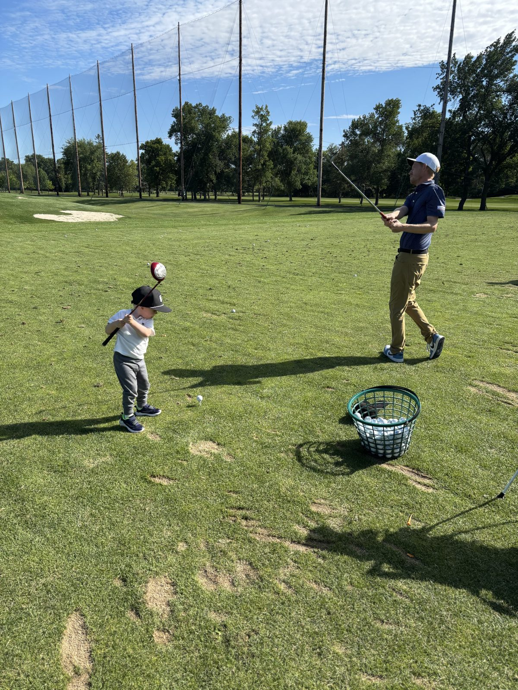
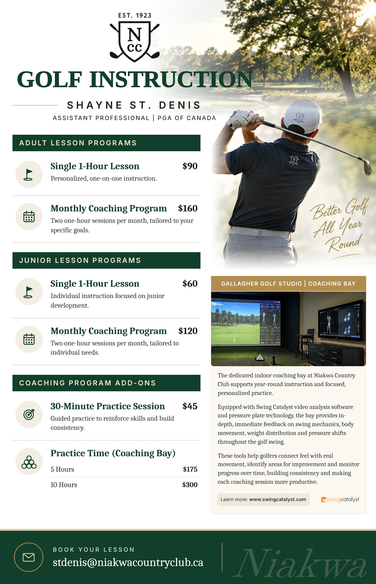

:::::: {.column-screen .band .band-soft .hero}
::::: {.band-inner .hero-split}
:::: {.hero-text}
[PGA of Canada Class 'A' Apprentice Professional]{.eyebrow}

# Golf instruction grounded in evidence.

::: {.lead}
I'm an Assistant Golf Professional at Niakwa Country Club in Winnipeg, where I teach individual and group lessons, run junior programming, and manage the club's tournaments, leagues and member events. I coach the way I research: measure what's happening, find what matters most, and build improvement one step at a time.
:::

::: {.btn-row}
[Book a lesson](mailto:stdenis@niakwacountryclub.ca?subject=Golf%20lesson){.btn-solid} [Lessons and rates](#lessons-and-rates){.btn-outline}
:::
::::

{.hero-photo fig-alt="Shayne St. Denis on the range at Niakwa Country Club with a young golfer"}
:::::
::::::

::: {.facts}
::: {}
[Credential]{.k} [PGA of Canada Class 'A' Apprentice]{.v}
:::
::: {}
[Club]{.k} [Niakwa Country Club, Winnipeg]{.v}
:::
::: {}
[Teaching since]{.k} [2023]{.v}
:::
:::

::: {.section}
## Instruction {.display #instruction}
:::

:::: {.card-grid}
::: {}
```{=html}
<svg aria-hidden="true" width="28" height="28" viewBox="0 0 24 24" fill="none" stroke="#1F5FA8" stroke-width="1.75" stroke-linecap="round" stroke-linejoin="round"><circle cx="12" cy="7" r="3.5"/><path d="M5 20c0-3.9 3.1-7 7-7s7 3.1 7 7"/></svg>
```
### Individual lessons
One-on-one coaching built around your game, whether that is your swing, short game, putting or course management, with a clear plan to practise between sessions.
:::

::: {}
```{=html}
<svg aria-hidden="true" width="28" height="28" viewBox="0 0 24 24" fill="none" stroke="#1F5FA8" stroke-width="1.75" stroke-linecap="round" stroke-linejoin="round"><circle cx="8" cy="8" r="3"/><circle cx="17" cy="9" r="2.5"/><path d="M2.5 20c0-3.3 2.5-6 5.5-6s5.5 2.7 5.5 6"/><path d="M14.5 14.5c.8-.6 1.6-.9 2.5-.9 2.5 0 4.5 2.2 4.5 5"/></svg>
```
### Group instruction
Clinics and small-group sessions for friends, leagues and members who want to learn together.
:::

::: {}
```{=html}
<svg aria-hidden="true" width="28" height="28" viewBox="0 0 24 24" fill="none" stroke="#1F5FA8" stroke-width="1.75" stroke-linecap="round" stroke-linejoin="round"><path d="M6 21V3"/><path d="M6 4l11 3.5L6 11"/><path d="M3 21h10"/></svg>
```
### Junior programming
Age-appropriate programs that build fundamentals, etiquette and a lasting love of the game.
:::
::::

## Lessons and rates {.display #lessons-and-rates}

Winter 2026–27 programs, taught in the Gallagher Golf Studio coaching bay at Niakwa. To book, email [stdenis@niakwacountryclub.ca](mailto:stdenis@niakwacountryclub.ca?subject=Golf%20lesson).

[{.flyer fig-alt="Golf instruction rates with Shayne St. Denis. Adult: single one-hour lesson $90; monthly coaching program (two one-hour sessions per month) $160. Junior: single one-hour lesson $60; monthly coaching program $120. Add-ons: 30-minute practice session $45; coaching bay practice time, 5 hours $175 or 10 hours $300. Book at stdenis@niakwacountryclub.ca."}](files/golf-lesson-details.png)

[Open the full-size rate sheet](files/golf-lesson-details.png){.small-link}

:::::: {.column-screen .band .band-soft}
::::: {.band-inner}
## At the club {.display}

Beyond the lesson tee, I help run the golf operation at Niakwa: the work that makes a season of member golf happen.

::: {.rows}
::: {}
[**Tournaments and competitions:** club championships, season-long match play and themed member events]{}
:::
::: {}
[**League administration:** scoring, standings and results through Golf Genius]{}
:::
::: {}
[**Member communications:** event announcements, results and programming updates]{}
:::
::: {}
[**Shop operations:** back-shop operations and staff supervision]{}
:::
:::
:::::
::::::

:::::: {.column-screen .band .band-dark}
::::: {.band-inner .cta}
::: {}
## Ready to work on your game?
Lessons at Niakwa Country Club · Winnipeg, Manitoba
:::

::: {.btn-row}
[stdenis@niakwacountryclub.ca](mailto:stdenis@niakwacountryclub.ca?subject=Golf%20lesson){.btn-solid}
:::
:::::
::::::
